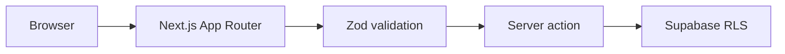

# Next.js Supabase Production Starter

An opinionated Next.js starter with the boring production safeguards already in place: strict TypeScript, protected server actions, RLS, security headers, tests, and CI.



## Quick start

```bash
cp .env.example .env.local
npm install
npm run dev
```

Apply `supabase/migrations/0001_notes.sql` in a development project. The integration guard accepts only exact loopback hostnames; remote projects are blocked. The current suite tests this guard, not database integration.

Read [architecture](docs/architecture.md), [runbook](docs/runbook.md), and [security policy](SECURITY.md).

MIT License © William Lima
